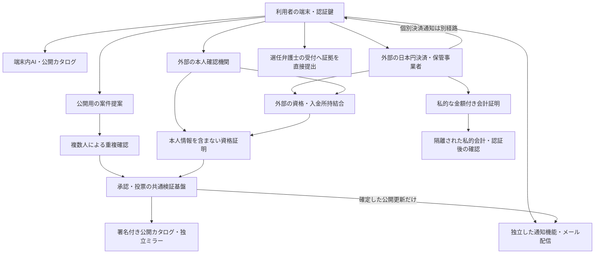

# action.anxol.com：後続実装の詳細要件仕様

日付：2026-10-09。版：0.4（v0.3の要件を維持し、2026-10-14レビュー指摘1〜3の状態遷移・台帳・確定競合を修正した承認待ち案・再レビュー待ち）。担当：仕様定義はコーディネータ、独立レビューはOrcaの監督付きワーカー。修正記録は `docs/reviews/2026-10-14-review-fixes.md` を参照。数値提案の承認・G-01〜05の解除・本番実装完了を意味しない。

本書は実装する機能・守る境界・受入条件・本番化の判断条件を定義する。実装、実際のメール送信、本人確認、円決済、コントラクトのデプロイは今回行わない。技術・外部事業者が未選定の項目には解除条件を定め、その条件を満たすまで該当機能を本番で有効にしない。ユーザーが了承済みの要件と、本書が提案する初期ルールを区別する。

## 1. 目的と優先順位

目的は、同じ出来事の当事者が共同相談を組織し、円で費用を拠出し、参加者が弁護士を選べること。その過程で、当サービスに本人確認資料や被害の証拠を集積しない。開発者・作成者・大口出資者が案件・投票・共同資金を単独支配しない。

### 1.1 ユーザーが決めた要件

| ID | 必須要件 |
|---|---|
| U-01 | 通知のためメールアドレスを収集する。メール不要案は撤回。ログイン方式をメール認証にすることまでは未決定 |
| U-02 | 当サービスが持つ非公開の本人情報は最大でもメール程度。身分証・顔写真・氏名・住所・生年月日・証拠原本を受け取る構成を避ける |
| U-03 | 案件作成時にAIで類似候補を探し、複数人が同一案件の有無を確認して案件を決める |
| U-04 | 弁護士は自薦・他薦の候補から参加者が選ぶ。投票は1人1票の方向とし、出資額で票を増やさない |
| U-05 | 利用者は日本円で払える。暗号資産の購入・ウォレット接続を必須にしない。中央の単独決定者を置かない設計を目指す |

本文の人数・時間・保存期限・投票方法は、実装可能性をレビューするための初期提案。ユーザーの既決定事項として扱わず、本書の承認時に採否を確認する。

### 1.2 既存資料との関係

既決定のU-01〜05を維持する。以下は本書の承認後に適用する置換・継承表であり、既存方針ファイルそのものは今回変更しない。旧文書の未承認運用数値を自動継承しない。

| 論点 | 維持・優先 | 置換対象・承認待ち |
|---|---|---|
| 個人情報・通知 | 通知メールを収集、身分証・氏名・住所・証拠は非取得 | 原本保管・私的体験送信の旧案を持ち込まない。認証方式は未承認 |
| 事件と募集 | 同一事件に別募集、AI候補を複数人で確認 | 旧「一律事前承認なし」を第8節へ置換。人数・異議期限は未承認 |
| 選任と支出 | 弁護士選任は参加者1人1票、個別委任、利害排除 | 旧抽選審議役の選任を第10節へ置換。予算・検収・裁定は第11節の別権限案 |
| JPYと返金 | 円・ウォレット不要、`2026-09-29-jpy-payments.md` | USDC数値・トークン切捨て・既存金庫を円へ流用しない。固定バッチ方式は未承認 |
| 契約・費用・回収 | 使途別分離、既発生債務精算、同意なし資料移転禁止 | 回収金は共同出資と別管理。契約主体・責任はG-05確認前に断定しない |

20指摘の対応と未証明条件は `docs/reviews/2026-10-09-requirements-review-summary.md` に記す。

## 2. 現状と差分

| 対象 | 現在の根拠 | 後続実装で必要な差分 |
|---|---|---|
| 認証 | `web/src/proxy.ts` と `lib/auth.server.ts` の共有Basic認証、Firestoreの試行回数 | 検証環境の入口認証と参加者認証を分離。Basicアカウントを投票資格にしない |
| サインイン | `groupB/SigninFlow.tsx` はタイマーによる送信表示例 | 本物の認証、宛先確認、通知の同意・停止。デモ省略導線は本番から除外 |
| 下書き・公開プレビュー | `groupB/draft.ts`、`lib/publishedPreview.ts` のlocalStorage | 私的な説明をサーバーに自動同期しない。旧データを無断で移行・公開しない |
| 類似検索・案件承認 | `groupB/SimilarStep.tsx` はタイムズカー固定例 | 公開案件カタログ、端末内AI検索、候補比較、複数人の署名付き審査（現状はタイムズカー固定候補の直接選択） |
| 参加・資料 | `groupB/JoinFlow.tsx` はファイル情報の表示デモ、`lib/joinDemo.ts` は件数等を端末保存 | 当サービスの証拠ファイル選択・アップロード導線を廃止。選任弁護士への直接提出案内へ置換 |
| 費用・弁護士・投票 | `groupC/ProposalsView.tsx` に旧審議役採択、`DecisionView.tsx` は相談結果なし、円決済は表示例。Solidityはトークン金庫の試作 | 円決済の外部接続、本人重複排除、候補の同意・資格確認、検証可能な投票と支出承認 |

GCPの配信・認証・ログ、メール配信、円決済には中央の事業者が残る。現在のデモも、新しい仕様に沿った分散システムとして稼働しているわけではない。

## 3. 構成の選択

| 案 | 内容 | 判断 |
|---|---|---|
| A：公開決定の検証と外部サービスを分離 | 既存の合意基盤で承認・投票・ルールを検証。公開案件は複数配信元。メール・本人確認・円決済は外部の専用機能 | 推奨。参加者の決定を開発者から分離し、個人情報の集積も抑えられる。外部事業者への信頼は残る |
| B：複数組織による署名付きWebサービス | 署名・定足数で決定を検証し、複数組織が運用 | 代案。試作は容易だが、共通DB・運用組織の停止や検閲への依存が残る |
| C：資料・決済・本人情報までチェーンや公開IPFSへ集約 | 公開基盤を全データの保管先にする | 不採用。削除・秘密保持の条件を満たさず、日本円の保管も代替できない |

Aを実装候補とする。独自チェーン・独自PoW/PoS・投票用の売買トークンは作らない。既存のチェーンまたは同等に検証可能な合意基盤の選定はG-04で行う。PoW/PoSは人の一意性や弁護士の適性を保証しない。

### 3.1 データの流れ

メール・決済・本人確認の障害で、確定済み投票を書き換えたり開発者が代理投票したりしない。合意基盤上の最終状態と、配信用の検索インデックス・メール送信状態を区別する。

## 4. 個人情報と保存の境界

### 4.1 受け取る情報

| データ | 当サービスの扱い | 公開可否 |
|---|---|---|
| メール・配信同意・購読対象・確認状態 | 通知専用の保管領域。暗号化し、通知担当だけアクセス | 非公開。案件への関心・参加推測も漏えい対象と扱う |
| 認証のランダムID・公開鍵・失効情報 | 認証用。投票の秘密鍵・身分証と結び付けない | 原則非公開。ランダムIDだけで匿名化済みとは言わない |
| 本人確認・参加資格の証明 | 必要な条件の成否、発行元・有効期間・失効確認のみ | 公開証明に本人属性・外部サービスの照会IDを含めない |
| 投票と使用済み印 | 案件・選挙単位の証明として検証。メール・認証IDを付けない | 検証に必要な記録のみ。選挙をまたぐ追跡可能性を評価 |
| 円入金・返金の状態 | JPY整数金額、募集ID、ランダム取引参照、状態、署名のみ | 個別金額・時刻・照会IDは原則公開しない。合計と支出決定を公開 |
| 公開案件・弁護士提案 | 公開を意図した情報に限定。弁護士の職業情報は本人の同意が前提 | 公開可能。被害当事者の個人情報を記載しない |

「被害当事者の非公開本人属性はメールだけ」という目標であり、取引・認証・購読記録までなくなるわけではない。公開の弁護士名・登録情報も人の情報であり、公開職業情報の取り扱いをG-05で確認する。メールと投票を別DBに置くだけで完全な匿名性が実現したとは扱わない。

### 4.2 禁止事項

- 当サービスへの身分証、顔画像、被害当事者の氏名、住所、生年月日、被害の証拠原本、カード番号、口座番号のアップロード・転送・API取得。
- 私的な情報の外部AI送信、学習への提供、分析SDK・セッション録画・広告用トラッキング。
- 個人情報・メール・証拠のハッシュを匿名化の代替として公開チェーンに保存。暗号化した証拠の公開IPFS保管も採用しない。
- URL、ログ、エラー報告、イベント解析、Webhook丸ごと保存、バックアップへの本人確認情報の混入。
- メールアドレスを票の重複排除キーにすること。複数メールや複数カードの制限だけで1人1票と表示すること。

### 4.3 保存期限の初期提案

以下の期限は未承認。削除対象を稼働系だけに限定した説明で外部コピーを隠さない。

| データ | 期限・削除条件 |
|---|---|
| 未確認通知・確認トークン | 24時間で失効・稼働系削除。トークンはハッシュ保存、URL・ログへ出さない |
| 確認済み宛先・購読 | 同意期間中。停止は直ちに抑止、削除要求後72時間以内に稼働系・複製・外部宛先帳/未確定キューから削除 |
| メール運用記録 | 宛先・本文なし、ランダム送信ID・成否・テンプレート版のみ7日。遅延Webhookも削除済み宛先を復活させない |
| 通知バックアップ | サービス・事業者とも最大30日で失効/消去。復元時は独立抑止履歴の最新世代を適用するまで送信不可 |
| 独立した停止・削除履歴 | subscriberId、単調増加generation、停止/削除時刻のみ。宛先なし。対象を含む全バックアップ・複製・外部キュー消滅の証拠がそろうまで保持 |
| 認証セッション・チャレンジ | セッション8時間、チャレンジ5分/単回。鍵失効・全セッション失効は既発行分にも各保護操作で即時適用 |
| アクセス・エラー記録 | IP・URLパラメータ・本文を保存せず7日以内。GCP/CDN/監査ログ等の自動保存はG-01〜03で別途確認 |

抑止履歴は通知DBと同時に巻き戻らない独立の耐久保管・複製を要する。generationの欠落・古さ・整合不明を「停止なし」と解釈せず、通知系全体を `RESTORE_BLOCKED` にする。72時間の削除と30日のバックアップ消去は別の約束で、復元バックアップの削除済み行も送信許可にしない。抑止履歴の消去は全コピー消滅の署名付き証拠を要する。すでに配達済みのメールは回収・削除を保証できない。

期限・閲覧不能権限・法定記録の扱いを外部事業者と法務で確認する。条件不成立ならG-01/G-02/G-03は未達のまま。保存しないことを責任ゼロの根拠にしない。

## 5. 利用者認証とメール通知

### 5.1 AUTH要件

AUTH-01：通常のログインはパスキーを初期提案とする。通知購読は任意で、閲覧・投票をメール登録の有無で差別しない。メールの入力欄は「通知先」と表示し、本人確認や投票資格の取得に使うと説明しない。

AUTH-02：WebAuthnの公開鍵とランダムIDで認証する。チャレンジの期限・単回使用、origin・RP ID・署名・user verificationをサーバーで確認。Secure/HttpOnly/SameSiteのセッション、CSRF対策、権限確認は画面を迂回した直接API呼び出しにも適用する。秘密鍵・指紋・顔画像を取得しない。

AUTH-03：ログイン鍵と投票資格の秘密を分離する。認証の複数登録は投票権の追加にならない。予備パスキーの追加は既存の認証を要し、メールリンクだけで投票資格を再発行しない。

AUTH-04：全鍵の紛失時の復旧はG-02で設計・検証する。認証の復旧と投票資格の復旧を同一視しない。安全な資格復旧が確認できない間は、進行中の選挙への新資格追加・秘密の再発行を禁止し、投票不能となる条件を事前表示する。集計後に投票を取り消して追加票を認めない。

AUTH-05：検証環境の共有Basic認証は入口保護として維持可能。ただし参加者認証・資格証明を代替しない。環境間で鍵・Cookie・配信先を分離し、本番でデモの認証省略導線を残さない。

AUTH-06：セッションに鍵ID・accountSessionEpoch・発行時刻・期限を結び付ける。保護操作のたびに鍵の有効性と現在epochを検証し、失効鍵のセッション・epoch不一致を拒否する。鍵追加/削除、復旧、通知宛先変更、アカウント削除には5分以内の再認証を要する。全セッション失効はepochを原子的に進める。認証基盤が照合不能なら保護操作を拒否し、8時間まで生存を許さない。認証失効と資格失効は別状態で、認証鍵の削除・購読削除で過去票・使用済み印を消さない。

AUTH-07：全認証鍵の紛失時でもMAIL-06の停止専用トークンで通知停止できる。宛先削除は確認済み宛先へ送る目的限定・15分・単回の削除チャレンジで可能とする初期案。これは購読の抑止/削除だけを許し、アカウント操作・鍵追加・資格復旧へ権限を広げない。新しい宛先への変更は通常の再認証を必要とする。メールを所持しても進行中選挙の秘密を再発行しない。

### 5.2 MAIL要件

MAIL-01：本人が通知先・公開更新の購読対象・目的・頻度を選ぶ。24時間/単回の確認トークン使用までは確認メール以外を送らない。メール任意、通知の有無で出資・投票・委任を制限しない。GETで購読開始・再開しない。

MAIL-02：初期メールは確定した案件審査結果、募集期限、公開候補、投票開始/終了、公開精算状況という案件全体の公開更新だけを扱う。個別入金・返金・失敗は含めない。件名/本文は「更新があります」等とし、案件名、被害詳細、個別額、投票先を含めない。詳細は認証後のアプリへ。URLにメール・資格・取引IDを含めない。

MAIL-03：通知領域はemailと公開購読対象だけを持つ。公開更新からsubscriberIdへ配送するが、個別取引参照・会計の所有者・投票秘密・認証IDへの結合表を持たない。決済個別通知は隔離された認証後の私的会計照会、または決済事業者から本人へ直接通知する別経路とする。後者の宛先・停止・内容・保存・関連照合はG-03で確認するまで有効にしない。購読だけから関心を推測できる残余リスクは説明する。

MAIL-04：公開決定の最終性を検証し、公開更新ごとに一意なpublicUpdateId/subscriberId/generation/テンプレート版の冪等キーでジョブを作る。再試行24時間・最大3回の初期案。送信直前に最新の確認状態・抑止generationを再照合する。通知失敗は投票を変えない。Webhook署名・期限・許可フィールドだけを解析し、生本文を保存しない。

MAIL-05：停止は独立抑止履歴へ原子的に記録し、未確定の内外キューを取消す。`QUEUED` → `SEND_COMMITTED` の送信確定点は、配信事業者が最新generationを検査して取消不能な配送へ引き渡す時点とする。購読単位（publicUpdateId・generationをまたぐ）でSEND_COMMITTEDかつ配送終端未確認のジョブは最大1件。同じ購読の停止・commitSend・終端確認を直列化し、commitSendは最新確認/抑止世代の一致と未終端件数0の照合、1件枠の予約、内外の確定記録を原子的に成立させる。停止が先なら送信拒否、確定が先なら当該1通だけは停止後に到着する可能性を表示する。事業者の予約/再試行キューへの投入自体は確定点にしない。同一指示/冪等キーの内外配送と全再試行を照合し、配達完了または以後配送/再試行不能の確定失敗を外部署名付き終端証明で確認するまで枠を解放しない。配達完了の場合も全再試行終了と以後の重複配送不能を確認する。単なる受付/FAILED/タイムアウトは終端でなく、不明・障害・UNKNOWNでは次の確定を拒否する。復元/ログ期限でも未終端枠を忘れず、照合欠落ならRESTORE_BLOCKED。事業者の原子的枠制約・確定点/停止順序・終端/再試行の重複配送防止・最大滞留・履歴照合を証明できないならG-01未達。送信確定済み・配達済みメールの取消を保証しない。これらの停止条件は未承認提案でありユーザー決定へ自動昇格しない。

MAIL-06：停止専用POSTは非推測・署名検証可能な不透明トークンに購読ID・停止だけの目的・世代を結び付ける。ログイン、Basic認証、Cookie、通常CSRF、利用者の操作署名を要求せず、この権限だけで同一購読を冪等に停止する。停止済みへの同じtoken再POSTは既存の停止結果を返し、旧世代を再開権限にしない。購読開始/再開・宛先取得・資格復旧は拒否。GETは確認画面だけ。通常の購読編集はAUTH/CSRF/署名に従う。RFC 8058を採る初期案ではDKIMでList-UnsubscribeとList-Unsubscribe-Postを署名し、`List-Unsubscribe=One-Click` のPOST、HTTPS、リダイレクトなしを受入条件にする。トークンURLをログへ残さない。停止後の再登録は新subscriberId・新確認を要し、旧IDは復活させない。広告・開封/クリック追跡は採用しない。

## 6. 外部本人確認と1人1資格

ID-01：利用者は外部機関へ直接移動し、当サービスのサーバー・フォームを経由せず必要情報を提出する。当サービスのアカウント・APIキー・管理画面から生の本人情報を閲覧できない契約と技術権限を要求する。APIで取りに行かないだけでは条件達成としない。

ID-02：発行資格は、発行者、対象募集、確認した条件、発行・失効・有効期間、署名、暗号学的な所持証明に限定する。氏名、住所、誕生日、メール、証明書番号、外部で生情報を照会できるセッションIDを含めない。当事者性や参加条件の確認が必要な場合も外部で行い、条件の成否だけを証明する。

ID-03：同じ人が複数メール・複数アカウント・異なる種類の身分証・複数回の確認を使っても、同じ募集に同時に複数の有効資格を持てないこと。通常の本人確認成功フラグだけではこの要件を満たさない。外部機関の重複判定範囲、誤判定の異議、本人情報の保存とアクセス権をG-02で検証する。

ID-04：初期構成では募集ごとに共通の資格発行機関とポリシー版を固定する。複数発行機関を併用する場合は機関をまたぐ同一人物の排除を検証するまで有効にしない。発行機関が虚偽の資格を作らないという信頼は残り、参加者による集計検証だけでは取り除けない。

ID-05：資格を暗号学的に所持証明し、第10節の投票ラウンド単位の使用済み印で二重投票を拒否する。同じ資格から異なる候補へ再送、別端末、並列実行、別リレイヤー、API直呼びでも1回に限定する。メールやユーザーIDを投票証明の公開入力に含めない。Semaphoreは候補技術だが、採用・監査・匿名性の確認前に安全性を断定しない。

ID-06：外部の資格・決済結合担当は、募集条件を満たす自然人本人、本人が所持する資格秘密へのcommitment、本人に属する対象入金の返金権利を直接確認する。決済事業者の署名付き入金権利を、本人のチャレンジ署名/所持証明と一緒に確認し、外部でのみ一意に消費する。発行する資格は募集・支援区分・条件成否・commitment・結合ポリシー版を含み、入金額・取引ID・氏名・外部照会IDを公開証明に含めない。当サービスに本人と入金の連結表を作らない。

ID-07：他人の署名済み入金証明だけを提示、同じ入金権利の複数資格利用、他募集転用、応援支援の資格転用は `HOLDER_MISMATCH` / `RECEIPT_ALREADY_BOUND` / `SCOPE_MISMATCH` / `SUPPORT_ONLY` で拒否する。初期案は当事者本人の1円以上の確定拠出を要し代理払いを認めない。複数拠出は外部で募集単位の同一返金権利へ集約し、票は増やさない。返金先変更・権利移転も外部の所持確認と署名を要し、アプリのメール所持では代替しない。生情報を返さずこの結合が実現する証拠がない間はG-02/G-03合同未達。

## 7. 公開案件の作成と端末内AI

CASE-01：事件を表す `eventId` と、対象者・目的・予算を表す `recruitmentId` を分離。同じ事件に個人会員・法人会員等の複数募集を許容する。同一事件の判定を、資金・参加者・証拠・委任の自動合算に使わない。

CASE-02：初期版の送信可能な提案は、公開組織ID・サービス名、出来事の分類、発生期間、公表日、公開出典、相談目的の選択肢に限定する。タイトル・要約は公開項目から定型生成し、本人の体験を自由記述で送る機能は初期版に設けない。個人への通知メール、会員番号、私的URL、ファイルは受け付けない。出典URLはHTTPS・許可した公開ドメイン・許可したパスだけとし、資格情報・クエリ・フラグメント付きURLを拒否。サーバーによる任意URL取得を禁止する。

CASE-03：公開情報にも個人情報が含まれる可能性を前提に、サーバーのスキーマ検証、制限長、エスケープ、公開前の人の確認を行う。不適切な提案は公開ミラーへ複製せず、最小限の理由コードで差戻す。入力ミスや悪意あるリクエストの受信まで技術的にゼロと保証せず、ログ・保管・公開への拡散を防ぐ。

AI-01：公開案件カタログとモデルを端末へ取得し、検索語・提案内容を外部推論APIへ送信しない。公開索引は案件単位の検索語をURLに送らない形で配信する。WebGPUが使えない場合はCPU/WASMを使う。AIが端末で実行できない場合は `AI_UNAVAILABLE` とし提出を拒否、対応端末での再試行を案内する。通常検索は閲覧専用。人だけの本番提出へ切り替えない。

AI-02：組織・分類・期間・公表資料の一致を説明可能な候補抽出に使い、日本語の意味類似で順位付けする。上位10件と一致・相違の属性、モデル版、カタログ版を表示。類似度は確率・事実認定・法的評価と表示しない。候補ゼロでも新規事件を自動承認しない。

AI-03：候補確認後にカタログ版または提案が変われば検索を再実行し、古い確認を確定根拠として流用しない。審査者は候補以外の公開カタログも検索できる。並行して確定した事件との再照合を、最終承認時に行う。

AI-04：モデル・ライセンス・配布元・ハッシュ・端末性能は実装開始前に記録する。検証用の公開または合成データで、同じ事件の言い換え・追加公表、同じ会社の別事件、別会社にまたがる同事件、別募集を含む50対以上の確認集合を固定する。初期の受入目標は重複ペアの上位10件への再現率90%以上、検索中の私的情報の外部送信0件。未達ならAIを備えた本番案件作成が未達であり、本番提出・審査開始を有効にしない。人のみの確認は試作に留め、限定本番を望む場合はU-03変更として別途ユーザー承認を要する。モデル取得量・待ち時間を先に示し、30秒で処理が終わらなければ提出不可のまま再試行か閲覧用通常検索へ案内する。50対以上には重複/非重複の件数、種類別成績、端末/モデル条件を記録する。

AI-05：初期対象は登録済み組織/サービス、分類、特定可能な期間、公表日、許可出典をそろえられる公開事件に限る案。出典なし、組織未登録、期間不明は `OUT_OF_SCOPE` で提出不可とし、個人情報なしの登録待ち/外部相談案内を示す。私的自由記述・証拠追加で補わない。`submitProposal` はAI評価達成証拠の対象モデル版と、端末検索のモデル/候補集合/カタログ版を検証する。端末からの実行申告を暗号学的実行証明とは呼ばず、偽造防止の保証範囲はG-04に残す。

## 8. 複数人による案件確定

### 8.1 最終確定まで集金しない

| 状態 | 遷移・集金可否 |
|---|---|
| `LOCAL_DRAFT` / `SUBMITTED` | 公開項目だけ送信。スキーマ/AI/版が有効なら `UNDER_REVIEW`、不備は `NEEDS_CHANGE`。集金不可 |
| `UNDER_REVIEW` | 72時間で単一結論の3/5が成立すれば `PROVISIONAL_APPROVED`、不能/不足は `REVIEW_EXPIRED`。集金不可 |
| `PROVISIONAL_APPROVED` | 公開基盤の暫定決定確定時刻から7日異議窓口。メール到着は起算点にしない。集金不可 |
| `OBJECTION_CHECK` / `DISPUTED` | 受理判定48時間、受理後別パネル72時間の再審査。新規募集の集金不可 |
| `RECONCILING` / `FINALIZATION_WAIT` | 暫定承認後の最新カタログ再照合/確定待ち。無関係競合の回数失効なし、再署名/12日上限/CASはCASE-09に従う。集金不可 |
| `FINAL_NEW` / `FINAL_LINKED` | 異議終了と原子的版照合を経た最終確定。募集条件・全関連Gを満たしてのみ集金可 |
| `NEEDS_CHANGE` / `REVIEW_EXPIRED` / `REJECTED` | 自動承認なし。新提案版・新ラウンドで再提出。既存署名流用不可 |

CASE-04：5人パネルの1人は1ラウンドに最終結論1つを署名する。署名対象は提案ID/版/ハッシュ、募集条件ハッシュ、審査ラウンド、候補集合/版/ハッシュ、公開根拠、比較対象カタログ版、ルール、期限、結論 `NEW` / `LINK(eventId)` / `UNDECIDABLE`。候補ごとの比較は補足であり確定票に数えない。通常審査は72時間、同一結論3/5が必要。判断不能3票は承認にしない。締切までは結果を仮集計し、矛盾署名のある者は両方無効、署名の撤回・差替えは認めず締切後は新ラウンドを要する。提出期限は72時間、受理済み決定の検証有効期間は暫定承認から12日までと区別し、異議窓口の途中で署名が提出期限だけを理由に失効しない。先着で矛盾の片方を選ばない。パネル5人固定なので一人一結論の下で異なる結論各3票は成立しない。そう見える入力は矛盾/不正として拒否する。

CASE-05：作成者、出資/参加予定者、応募予定弁護士、相手方関係者、各人と雇用/家族/経済関係のある者を当該審査から除外する初期案。自己申告に加え外部確認・公開理由コードと異議を要する。資料は運営に集めない。独立とは、同じ自然人/管理主体/利益関係を共有せず、初回の5人と再審査の5人が重ならないこと。初回と再審査を事前に各5人確保し、除外・辞退後に10人を下回れば開始しない。

CASE-06：募集用資格とは別の `reviewer-pool/environment/term/policyVersion` scopeで外部自然人重複排除した母集団を作る。母集団15人以上・任期90日の初期案とし、15人の名目人数よりも利害除外後10人の確保を優先する。任期満了は新ラウンド担当不可、既存担当にはラウンド満了まで限定任期を署名する。公開鍵・資格/失効・独立主体・利害宣言だけを記録。母集団snapshotを固定後、未来の最終化済み公開乱数で順位を決め、辞退/欠員は順位順補充、開発者選択不可。初回の待機上限14日、未確保なら `REVIEW_EXPIRED`。追加/除外/交代は第13節の3/5で行い、独立人数不足を定足数引下げで回避しない。

CASE-07：異議は審査者資格または当事者条件の外部証明を持つ者が、候補eventId・公開根拠・理由コード・提案版を署名して期限内に提出する。同じ根拠ハッシュ/理由の繰返しを拒否し、裸の反対票は受理しない。初回と別の5人が48時間以内に3/5で適格/新規根拠を受理判定し、受理後72時間以内に同じ5人で単一結論3/5を署名する。受理否決は異議期間終了まで暫定状態、判定不能/期限切れ/再審査不能は `REVIEW_EXPIRED` として集金しない。再審査の結論変更は新提案版として通常審査からやり直し、同じラウンドで再異議窓口を無限に開かない。暫定承認から最大12日で最終化または期限切れ。新根拠の期限後申立ては別訂正案件にし、既存事件の無関係な募集を停止しない。

### 8.2 カタログ確定を原子的に検証する

CASE-08：公開カタログ版は最終確定/参照訂正だけで単調増加し、検索投影・メール・草稿更新では増やさない。`finalizeEvent(expectedCatalogVersion, decisionHash)` は、現版との一致、異議終了、署名/期限、参照の非循環、資格を同じ合意基盤の一取引で検証し、事件ID/参照と次版を原子的に書く。版不一致なら `CATALOG_CONFLICT`、状態とeventIdは変えない。旧版からの同時確定は片方のみ成立し、他方は再照合へ戻る。タイトルハッシュで意味の同一性を決めない。

CASE-09：版競合では `RECONCILING` とし、端末AIと全パネルが最新カタログまでの差分を再照合する。候補追加/変更・比較属性/同一性判断が変われば関連競合として記録し、新ラウンド/全署名/異議窓口を要する。真の重複を無関係扱いせず、NEWのまま確定不可、LINKへの結論変更も通常の新審査を要する。無関係更新だけなら同じ5人が新カタログ版と不変の提案/結論/候補集合ハッシュ、差分範囲hashと無関係の理由に3/5で再署名し、公開の再照合記録を追加する。これでは提案/結論を変更できず異議窓口の開始時刻も変えない。無関係と確認できた競合は回数失効の対象外とし、最新まで再照合・再署名/確定待ちを継続できる。未分類を無関係として通さない。従来の「版競合3回で失効」は廃止し、関連競合は上記の新審査、未照合は保留で扱う。

再照合開始から48時間以内に再署名をそろえる初期案とし、途中の無関係更新で同じ再照合期間を延ばさない。専用再署名の有効期限は署名成立から48時間、かつ元の暫定承認から12日以内。無関係な版更新だけでは12日上限や異議開始時刻を延長しない。必要期限/3署名不足なら `REVIEW_EXPIRED`、旧版のまま確定不可。関連変更による新ラウンドはCASE-07の新提案版手続へ戻り、元ラウンドの期限をリセットして署名を流用しない。

異議終了/有効3署名を満たす案件は `FINALIZATION_WAIT` とし、同一ラウンドで最初に確定待ちとなった合意基盤時刻とproposalId順に処理する。無関係競合の再照合でも待機順位を保持し、後着の準備済み案件は先行準備済み案件を追い越さない。先行が再署名待ちなら未準備として他の準備済みを処理できるが、先行の再照合期限/12日上限を延長しない。各確定は最新カタログ版に対するCASE-08の原子的CASを必須とし、順番待ちは旧版承認の許可や安全な確定の保証ではない。実装時にはこの順序/再照合/期限を同じ合意基盤で検証し、処理容量不足でも無署名確定や自動延長で回避しない。

CASE-10：誤関連付けは別名参照の新版で訂正し循環参照・古い参照の新募集を拒否。公開本文は訂正/削除可能な配信に置き、本文をチェーンへ永久保存しない。既存資金/資格/委任を合算しない。最終確定後の訂正は未開始募集を保留、開始済み当該募集は新入金/新支出を保留して第11節の債務・返金処理へ、既払い・確定票は書き換えない。無関係募集は継続。個人情報疑いの単独表示保留は第13節の限定権限だけで、資金決定を変更しない。

## 9. 弁護士候補と参加条件

LAW-01：自薦は本人が提案し、他薦は推薦だけを登録する。他薦された弁護士の本人同意・資格確認・提案条件がそろうまで投票候補にしない。重複候補は登録番号等で外部確認する。登録確認の手順・対象情報・再確認期限はG-05で固定。

LAW-02：比較項目は公開の登録情報、対応範囲、費用と実費、時期、担当体制、必要な資料の種類、利益相反の確認方法、受任条件。勝率・AI点数で自動選任しない。公開プロフィールは本人の同意した職業情報に限り、私宅住所・本人確認原本を受け取らない。

LAW-03：利益相反・当事者性の資料は候補弁護士または外部確認機関へ直接提出し、当サービスは条件確認の成否だけを扱う。全候補へ全員の原本を渡さない。候補自身に自分の採否の投票権を与えない。

ELIG-01：初期案の投票者は、募集の参加条件を外部で確認し、出資の確定条件を満たし、期限までに資格を取得した本人。第三者の応援支援者の入金だけでは投票資格を付けない。出資額・複数入金・別アカウントで票数を増やさない。この参加条件はユーザー確認が必要な初期案である。

ELIG-02：同じ人が別募集の条件を満たせば別募集で投票できる。資金・投票者は合算しない。出資取消・資格失効は第10.3節に従い、分母や個別票を運営が選んで変更しない。

## 10. 弁護士選定の投票

### 10.1 初回と決選の資格・票を分ける

VOTE-01：選挙IDは環境/基盤をまたいでも再使用しない。開始前に募集、候補条件ハッシュ、資格集合rootVersion/rootHash、N、issuerPolicyVersion、ruleVersion、開始/各締切を固定する。rootは最終化済みの1つだけを初回・決選とも受理し、開始後の新資格/別root/発行者切替を拒否する。rootは集合所属の証拠、失効リストは現在の有効性判断として分ける。外部自然人重複/再発行履歴を確認できない集合は開始不可。

VOTE-02：投票ラウンドは `INITIAL` と `RUNOFF`。scopeは `H(domainTag, environmentId, consensusId, recruitmentId, electionId, roundId, ruleVersion)`。rootVersion・候補・認証ID・額をscopeに含めない。資格秘密とscopeから使用済み印を作り、同一scopeのnullifierを原子的に一度だけ消費する。証明にはscope、rootHash、候補集合ハッシュ、選択肢、操作期限を結び付ける。リレイヤーの選択差替え、別募集/環境再利用、同段階の別root・別端末・並列再送で追加票を拒否する。初回投票者も決選で別scopeの1票を持つ。安全な履歴横断復旧が証明されない間、進行中選挙で新秘密発行・新資格追加は禁止。認証復旧/メール所持/旧資格失効でこの制限を解除しない。

VOTE-03：候補1人または見送りに匿名資格付き1票、変更不可。投票受付は通知/認証Cookieに依存せず資格所持証明を検証する候補方式をG-02で評価する。公開検証可能な票/印はアカウント/メール/IPを持たない。少人数の推測、買収、鍵譲渡、フロント改変、外部共謀を防いだ完全秘密投票と表示しない。

VOTE-04：開始時資格者N、当該段階の有効投票者Tに対し `Q(N)=max(3, ceil(N/2))`、`T>=Q(N)` を要する未承認案。N<3は開始不可。N=3ならQ=3、N=5ならQ=3、N=6ならQ=3。段階ごとに過半数 `floor(T/2)+1` を得た選択肢を採択。棄権・未回答はTに数えない。見送り過半数なら `DECLINED`、候補0人は開始不可、候補1人+見送りは開始可。

VOTE-05：初回7日、過半数なし/定足数ありなら上位2選択肢で決選3日。見送りも含む。1位同票がちょうど2選択肢ならその2者、3者以上同率首位/2位同票で2つに絞れないなら `UNDECIDED`。決選のN/root/Qは初回と同じ、Tは決選票だけ。決選同票/定足数不足/初回定足数不足は未決。単独タイブレークなし。再選挙は新electionId・新集合を締切内で固定し、旧票/印の再使用不可。日程が収まらなければ終了・精算する。

### 10.2 全期限を募集に固定する

Dは集金を許した募集条件の公開確定時刻。以下の絶対期限と相対期限は未承認案。時計は第12節の合意基盤時刻を使い、アプリ時計やメール到着時刻は使わない。

| 区間 | 初期期限・拒否/終了 |
|---|---|
| 募集/着金・資格/候補 | 募集案内D〜D+21日。支払い開始・着金・資格・候補条件確定はいずれもD+7日締切。D+7日後の着金は資格なしで外部返金処理、公開募集画面は受付終了表示 |
| 初回・決選 | 初回開始はD+7日、終了D+14日。必要なら決選D+14日〜D+17日。結果暫定集計まで24時間、D+18日以内 |
| 結果異議/選任 | 暫定集計公開から48時間。外部署名付き失効・二重資格・候補不適合・検証不一致だけを受理し独立5人3/5で24時間内裁定。最終選任D+21日まで。未解決は選任しない |
| 契約・相談 | 契約条件/予算承認は選任後7日以内、相談実施はD+60日まで。前払/検収/裁定は第11節の個別期限も満たす |
| 精算・最終終了 | D+90日までに債務確定/保留・準備金・不足と第1返金バッチを公表。プロジェクトの新選挙/新支出はD+90日で終了。外部取消リスク終了後7日内に追加精算、未払債務/返金権利の法的存続は消さない |

`openElection` は全日程・異議/選任期限が収まること、必要N/候補/全Gを満たすことを検証する。D+20日の資格成立では開始不可。延長は原募集の全有資格参加者の明示同意を条件とする案で、未応答/反対があれば延長しない。反対者だけを除いて元の資金を継続しない。成立する延長でも新募集ID/新条件へ個別同意と外部移行を要し、旧募集の債務精算・返金を先行させる。

### 10.3 失効・辞退・障害を個別票削除に使わない

| 時点 | 取消/本人資格失効/候補辞退・失効の効果 |
|---|---|
| 開始前 | 最新外部署名・取引版を反映し条件を満たさない資格/候補を除く。集合/候補/全期限を再固定。人数不足は待機後D+7日で終了 |
| 初回/決選中 | 対象本人の客観的失効、資格条件を割る取消、固定候補の辞退/失効で選挙全体 `CANCELLED`。分母/個別票を減らさない。部分取消後も最低拠出条件を満たす場合は会計更新のみ |
| 締切後・結果確定前 | 同上で結果を確定しない。失効照合不能/基盤未最終化は `ON_HOLD`、選任期限まで回復しなければ終了 |
| 最終結果後・支出前 | 選任済み候補の辞退/失効、または参加者の客観的条件喪失は、確定結果を履歴に残し新規契約/支出を保留。新選挙が期限内で可能なら再選挙、不能なら債務留保して精算。落選候補だけの辞退/失効は候補履歴更新のみで、選任済み候補との契約/支出を止めない |
| 支出後 | 過去票・既払いを戻さない。選任済み候補の辞退/失効、または参加者の客観的条件喪失は新支出を保留し、取消損失・契約債務・不足を第11節台帳へ。選任済み候補の辞退/失効は契約と法務に従い直接受付先の変更を本人に案内。落選候補だけの辞退/失効は候補履歴更新のみで、新支出を止めない |

最終結果には `selectedCandidateId`（見送り/未決ならなし）と候補条件ハッシュを固定する。結果後の候補イベントは対象candidateIdを照合し、落選候補の単なる辞退や、落選候補に結果後に生じた資格喪失を、選任済み候補の喪失や選挙不正とみなさない。確定前からの候補不適合・二重資格・検証不一致等、選挙自体の有効性を損なう証拠を伴う申立ては別の選挙有効性異議とし、対象electionId・根拠hash・理由・外部署名/不正証明を要求する。通常の結果異議は第10.2節の期限に従い、最終結果後の新証拠は独立異議パネルの訂正/保留判断として記録する。落選候補の単なる辞退署名だけでは受理/共通保留を認めず、受理後の未解決は新規契約/支出を保留、再選挙は元の選任期限内のみで、不能なら債務留保精算とする。異議で過去票・既払い・元のFINAL記録を書き換えたり、期限を延ばしたりしない。

客観的証拠は認可発行者/決済事業者の最新失効・取引版署名、候補本人の辞退署名、資格登録の条件喪失証明、合意基盤の不正証明とする。疑いだけは独立異議パネルが48時間以内に3/5で根拠の受理と保留/却下を決め、投票者の名前や運営の理由だけで票を消さない。期限末基盤障害は署名なし結果を採択せず選任期限で `EXPIRED`、返金原資は独立会計/保管証明で処理可能なことをG-03で要求する。成立しない返金は未払権利と外部請求経路を表示し「返金済み」にしない。

VOTE-06：選任は共同相談先のみの決定。各人の正式委任・和解・請求放棄は直接手続。全鍵/資格秘密紛失は投票不能のまま当該段階を継続し、別資格で再入場させない。盗用が客観証明された場合は上表の中止経路。中止後の新選挙にも外部履歴横断一意性を確認し、確認不能なら新選挙なし。

## 11. 日本円の出資・支出・返金

PAY-01：JPY整数1円、安全な整数範囲で加減算/合計の溢れを拒否する。暗号資産購入・ウォレット接続・ガス用秘密鍵不要。リレー手数料と負担者は表示し無料と仮定しない。

PAY-02：外部決済/保管へ直接提出。当サービスを保管口座にせず、運営の通常/API/管理/請求/サポート/権限昇格/鍵再発行で氏名・口座・カード・生の照会IDを取得できないことをG-03で証明する。取引証明は募集、privateReceiptRef、JPY金額、取引版、状態別額、事業者イベント署名のみ。外部の本人・所持結合はID-06/07へ。条件の存在だけで実現済みと扱わない。

### 11.1 選任、予算、検収、裁定、送金を別主体にする

全人数・期限は初期提案。資金判断に用いる参加者集合は当該募集の外部一意資格者、支払先/候補・その関連者を除いた人数をNとして事前固定し、第10節と同じ段階別1人1票/定足数を用いる。金額による票数増加なし。除外でN<3なら契約/支出不可。独立パネルは第8節の母集団から当該案件の利害排除後に検収5人と裁定5人を重複なく確保する。相談の証拠原本は扱わず、履行の条件成否を弁護士/外部契約担当が署名する。

| 操作 | 主体・定足数 | 利害排除・期限・不成立 |
|---|---|---|
| 弁護士選任 | 資格参加者、Q(N)、有効票過半数 | 候補本人/関連者除外、第10節の日程。未決は契約不可 |
| 予算/契約/前払条件承認 | 資格参加者、Q(N)、有効票過半数の署名結果 | 選任だけでは支出不可。選任後7日内の3日投票、候補条件/受取人/上限/実費/手数料/支払段階/解除債務を固定。変更は新承認 |
| 請求・履行/前払条件確認 | 独立検収パネル5人中3署名 | 支払先/契約当事者/参加者/初回審査利害者除外、72時間。前払は履行済みとせず契約の前払成立条件・準備金・返還条件を確認 |
| 支出異議裁定 | 別の独立5人中3署名 | 検収者除外。検収公開後48時間異議、受理/裁定72時間。未解決は該当額拘束継続、期限だけで法的債務消滅なし |
| 通常支出の銀行実行 | 外部保管事業者の条件強制エンジン、承認結果+検収3/5+異議終了/裁定3/5 | 受取人/額/支出ID/版/残高の一致、支出許可最終化後72時間内。二重実行/権限迂回不可。人手例外も同じ契約を要する。返金/元決済返品は第13.2節の別種別条件 |

パネル任期は案件精算期限まで、同じ選任snapshot/乱数順位で補充、72時間で独立補充不能なら未決・保留。未発生の支出は期限で許可失効、既発生の債務は保留/外部解決へ。契約主体は募集前に外部の責任主体を名義・権限・責任込みでG-05確認し、当サービスが匿名集団を当然に契約主体と仮定しない。外部契約担当は承認条件と同一の契約のみ締結可能で、解除/債務確認の権限も事前契約に含む。

PAY-05：共同相談・訴訟費用・回収金は別会計。`authorizeDisbursement` は募集/予算/契約/受取人/請求/支払段階/署名/異議/残高の版を原子的に照合して該当額を予約する。予約から銀行実行まで同じdisbursementIdと冪等キー。外部振込照合が未着なら予約解除/再払いせず `EXECUTION_UNKNOWN` とする。

PAY-06：チェーン署名だけでは銀行を拘束しない。第13.2節の全銀行権限で単独迂回不可が契約・技術双方で成立するまでG-03未達。既存USDC金庫や単独pause権限をそのまま接続しない。

### 11.2 金額付き台帳と取消の因果順序

PAY-03：各入金は `CREATED/PENDING/SETTLED/FAILED/CANCELLED/PARTIALLY_REVERSED/REVERSED/DISPUTED`。SETTLEDは不可逆を意味しない。署名付きproviderEventIdを重複排除し、providerTransactionVersion/前版hashを照合する。新版で取消済みなら旧着金で復活しない。版欠落・順序飛びは `RECONCILIATION_REQUIRED`、最新外部署名付き照合が来るまで会計/資格を保留。自己申告/振込受付/成功レスポンスで確定しない。

| 台帳項目 | 金額・状態の契約 |
|---|---|
| 入金/取消/返金権利 | settledGross、reversalAmount、refundCompletedAmountをJPY非負整数で記録。部分取消額、取消後の有効拠出、本人単位の外部集約refを分離 |
| 現金・手数料 | 外部照合残高cash、確定feePaid、未払feeDue、使途別口座/会計を記録。支出送金/取消/返金による実現金変化は署名照合でのみ確定 |
| 債務・拘束 | legalDebtDue、承認済み未実行予約、異議中債務/取消準備金。各liabilityIdで同じ円を重複拘束しない。法的債務は異議期限切れだけで解除不可 |
| 支出・返金 | disbursement/refundInstructionごとにamount、CREATED/RESERVED/SUBMITTED/COMPLETED/FAILED/UNKNOWN。返金は固定originalAmount、累計completedAmount、取消相殺offsetAmount、未完了予約reservedRemaining、instructionVersion/実行版と終端照合証明を分離し、取消で未完了残額が0ならOFFSET_CLOSED。完了証明まで既払いにしない。FAILEDの同一実行版再試行は同じ指示/操作冪等キーを要し、相殺後の版変更はPAY-08のキー分離/終端証明契約に従う |
| 不足・補填 | refundPayableを含む全確定債務/拘束との差 `shortfall=max(0, obligations-cash)`。不足負担者・補填債権・回収額は別記録。新出資/他募集資金で黙って補填しない |

`obligations` は重複のない債務/準備金/予約/refundPayable/未払手数料の合計。`refundAvailable=max(0,cash-obligations)`。入金額だけで残金を算出しない。募集/使途別に `cash=開始残高+確定入金+実収補填/回収-実取消-確定手数料支払-実支出-実返金` を署名付き銀行照合と一致させる。非現金の補填債権はcashに足さない。過大取消による外部立替/借越はcashを偽造せず別債務に記録する。cash不足では新支出・新返金バッチを停止、既予約の自動実行も停止し、権利を維持する。取消後損失は原因本人へ外部請求する初期案だが他人へ自動転嫁しない。本人へ請求不能なら外部保管/契約主体の補填保証・保険・損失分担を募集前に専門家確認する。保証範囲/取消最大期間/準備金式を確定できない間はG-03未達で実受付なし。

PAY-04：集金前に本人条件、外部保管/契約主体、目標/上限、用途、予算上限と承認方式、手数料/取消リスク負担、返金方法、全期限を固定。D+7日の着金目標未達は選挙開始なし、未達・未決は未発生支出なしで精算、既債務は留保。募集受付はD+7日まで、選任までD+21日（第10.2節）。目標超過/締切後着金/不適格入金は資格にせず、外部の元決済へ返す個別返品台帳とし、按分原資・重みへ含めない。元決済返品に手数料がある場合の負担は事前合意を要する。 元決済返品は対象入金の最新providerTransactionVersion/前版hashと元返金権利の所持証明を既存の外部決済/保管事業者が照合し、返品台帳版・残余権利額・原資を原子的に確認/予約する。対象入金と元返金権利に一意な固定返品指示キーで元決済だけへ実行し、取消/既返品/予約と同じ円を重複消費しない。旧因果版/権利不一致/台帳競合/額超過/送金先変更を拒否し、FAILEDは同じ指示/冪等キー、UNKNOWNは終端照合前の再送金/予約解除不可。選任・弁護士契約・検収は返品の前提にしない。全経路の銀行強制は第13.2節、外部能力はG-03/G-05の未証明条件とする。

### 11.3 累計を再配分せず固定バッチを追加する

PAY-07：精算では同一募集・同一使途の有効拠出権利を外部本人単位のprivateRefundOwnerRefに集約する。複数入金で端数順位を増やさない。未取消の拠出額を重みwとし、対象集合/重みw/重み合計W/個人別残余権利cap/既払いと予約済み額/原資F/基準取引版/債務・準備金/手数料/同順位用のランダム参照辞書順を固定した `RefundBatch` を3/5裁定署名で確定。W=0、F<0、原資不足、照合不明はバッチ不可。各人の上限を `cap=max(0,有効拠出-確定した非返還費用負担-完了返金-未完了の固定返金予約)` として外部の権利台帳版へ結び付ける。Fはcashからの返金可能額かつcap合計以下、超過原資は返金権利のない保留金へ分けて裁定/法務確認する。配分は下記の上限付き最大剰余の未承認案とする。個別原票を公開せず合計/集合commitment/事業者集計署名を公開する。

配分はcap>0かつw>0の固定対象から始める。残原資f/対象重み合計Wに対し理想額f*w/Wがcapを超える者全員へcapを割当て、その者を除き残原資/重み合計を更新する。上限超過者がなくなるまで繰り返す（同時除外、整数の交差積で比較）。残対象にはfloor(f*w/W)を割当て、余りを端数降順/固定参照順でcap未満の者へ1円ずつ割当てる。全割当ての合計F、各人0以上cap以下を原子的に検証して予約する。対象・cap・予約台帳版が変われば未確定バッチを拒否して作り直し、確定バッチは変えない。cap=0の者へ端数が集中しない。未知/失敗/未請求の予約もcapから控除し、重複バッチの並行確定を拒否する。

確定バッチの対象・重み・原割当額・署名・過去の完了記録は不変。追加回収・拘束解除・手数料返還で原資が増えたら、新原資だけの新バッチを作る。累計原資で最大剰余を再計算しない。後の取消は新しい取引版・重みを次バッチへ反映し、既予約分は下記の署名付き追記相殺で現在の未完了予約を更新する（元バッチの履歴を減額/上書きしない）。すでに払った額は戻さず、権利超過分を外部債権/損失として別計上する。法的返還義務の判定は外部契約手続で扱う。

PAY-08：入金取消後の予約相殺は `offsetRefundReservation` とする。本人単位の最新有効拠出をc、確定非返還費用負担をn、署名確認済み完了返金をpとし、残存返金権利 `u=max(0,c-n-p)`、同じ本人の未完了予約合計をrとする。相殺必要額は `max(0,r-u)`、安全に未送金と確定した指示残額の範囲でのみ相殺する。部分取消でr<=uなら予約を維持し、新バッチのcapは `max(0,u-r)`。r>uなら確定時刻/batchId/固定指示キー順で必要額だけを相殺する。相殺後も不明予約がuを超えれば権利不整合として保留し、UNKNOWNを推測で解放しない。相殺が権利を減らす根拠は取消であり、未請求/期限切れ/FAILEDだけでは相殺しない。

既存独立裁定パネル3/5が、認可決済事業者の取消署名（providerEventId・最新因果取引版/前hash・募集/入金ref・取消額）、外部本人集約権利版、保管事業者の実行/終端照合署名、対象指示/前版/相殺額/残額、expectedLedgerRoot・前後予約台帳版を通常の署名エンベロープで承認する。生の本人情報・口座・Webhookは取得しない。外部保管の条件強制エンジンが承認を検証して、取消反映・送金確定・再試行・相殺・新バッチ予約を募集/権利単位で直列化する。取消受付で最新権利を反映/照合待ちにして対象の新送金を止めるが、3/5と終端証明がそろうまでは予約を残す。単独運用者のDB編集や事業者の無署名減額で解放しない。

`offsetRefundReservation` は最新取引版/権利版/指示版/ledgerRoot/予約台帳版へのCAS、取消・実行の署名検証、相殺仕訳の追記、reservedRemaining/対応する同一liabilityIdのrefundPayableの減少、instructionVersion更新と旧実行版の失効を同一の原子的更新で成立させる。取消自体を二度cashから引かず、相殺自体もcash/完了返金を変えない。各指示は `originalAmount=completedAmount+offsetAmount+reservedRemaining` を維持し、固定指示キーを変えず、未送金残額だけを最新実行版で支払える（部分相殺で0より大きければRESERVED、0ならOFFSET_CLOSED。旧SUBMITTED/FAILEDからの復帰は以後送金不能の終端証明を要する）。他の債務/準備金/法的権利を相殺に便乗して消さず、同じ円を予約とrefundPayableに二重計上しない。新残額を送金できる場合はexecutionVersionを更新し、旧実行版を無効にする。予約解放後の `refundAvailable=max(0,cash-obligations)` を再計算し、原資不足・照合不明がなければ他の有効権利へ新バッチを作れる。

| 取消と返金実行の関係 | 相殺・予約の扱い |
|---|---|
| 未送金が外部強制エンジンで確定 | CREATED/RESERVED、または確定不実行のFAILEDについて、旧版が今後も送金/再試行不能であることと同時に必要額を相殺。部分相殺残額の所持/権利照合は省略しない |
| SUBMITTED/UNKNOWN、タイムアウト、照合欠落 | 結果不明として全残額予約を維持。相殺/再払い不可。外部署名付き照合で、実送金完了額と以後実行/再試行不能の未送金額が確定してから未送金部分のみ相殺 |
| COMPLETED/送金確定が取消より先 | 完了額/実返金cashを維持。取消は最新権利へ反映し超過支払いを別債権/損失へ、送金済み額を予約解放の名目で再利用しない |
| 取消と送金が競合 | 同じ外部強制エンジンでCASと実行確定点を直列化。取消が先なら旧権利/指示版の送金を拒否、送金が先ならSUBMITTED/UNKNOWNとして照合まで拘束。内部CASだけで銀行を止められるとは扱わない |

取消イベントはproviderEventId/内容hashで一度だけ反映する。相殺仕訳は `(providerEventId,固定返金指示キー,相殺前instructionVersion)` を一意にし、同一キー/内容再送は同じ結果、同じキー/異なる内容は拒否。後からUNKNOWNが解決した場合はその新しい照合証明/指示版を根拠に別追記として残額を相殺できるが、前の相殺額を再解放しない。復元でも取消/相殺/実行履歴を失わず、欠落は照合待ちとする。

固定返金指示キー（権利/予約の識別）と、署名操作の `idempotencyKey` は区別する。`instructionVersion` は状態照合用、`executionVersion` は署名済み送金許可の版とし、照合/状態記録だけでは実行版を増やさない。executeRefundの署名操作キーは `(固定返金指示キー,executeRefund,executionVersion)` ごとに一意とし、同一実行版の再送/FAILED再試行は原承認の同じ操作キー・同じpayloadに限る。相殺操作のキーは前述の `(providerEventId,固定返金指示キー,相殺前instructionVersion)` とする。相殺後の新残額実行は新executionVersionの別操作キーを使い、同じ操作キーのpayloadを上書きしない（第12.2節の異内容拒否を維持）。外部銀行側の指示単位重複防止キーは全版共通で固定し、操作キーの変更を別の返金指示/追加送金枠にしない。銀行は固定指示単位で版横断の完了額/予約/累計相殺額を照合する。旧版の未送金残額が将来も実行/再試行不能との終端証明、裁定3/5の相殺、CASによる旧版失効が成立した場合のみ新残額実行版へ移れる。新しい操作キーを作っただけの再払い、UNKNOWNでの版更新/新実行は拒否する。額や版が異なる同一銀行指示を安全に失効・更新できる能力を要求し、単純な別キー送金で代替しない。

外部での原子的失効・全経路強制・終端証明・固定銀行指示の版更新の能力はG-03/G-05で未証明であり、実銀行で検証済みとは扱わない。

| 計算説明（実施済みテストではない） | 固定結果 |
|---|---|
| A:B:C=5:3:1、F=4円 | 切捨て(2,1,0)、端数はC>A>B。残1円をCへ、バッチ1=(2,1,1)、総額4円 |
| 追加原資1円、費用負担0の説明例 | 既払い控除後cap=(3,2,0)。Cを除き重み5:3、切捨て(0,0)、端数A>B。バッチ2=(1,0,0)、累計=(3,1,1)、総額5円。Cの既払い1円を減らさない |
| 累計F=5円の再計算 | (3,2,0)となり既払いと競合するため禁止。バッチ1を再開・上書きしない |
| 5:3:1に1円の追加バッチを9回、費用負担0 | Aが5円に達するとcap=0で除外、次にBが3円、最後にCが1円。10回目はcap合計0で拒否。予約済みも控除するため同時処理でも上限を超えない |
| cash=100円、未払債務40円、独立準備金10円、未払手数料5円 | obligations=55円、返金可能45円。100円全額返金を拒否 |
| 既支出後の取消でcash=20円、上記obligations=55円 | 不足35円、新支出/新バッチ停止。債務を期限切れで0にしない |

返金指示は `(recruitmentId,batchId,privateRefundOwnerRef)` の固定キーで一度だけ。FAILEDは同じ固定指示の同一実行版/操作冪等キー・payloadで24時間以内最大3回の初期案。相殺後の新残額版はPAY-08に従い別の操作キーとし、固定銀行指示キー/版横断重複防止は維持する、UNKNOWNは再送金せず外部照合を要求。未完了の失敗/未請求/UNKNOWNの原資は当該権利へ拘束し、完了額はcashと予約から消費済みとして控除する。取消で消滅した未送金分だけはPAY-08の追記相殺で解放し、OFFSET_CLOSEDは再試行不可。7日で解決しなければ外部請求案内、未請求30日後は外部の権利保管へ移す案をG-03/G-05で確認し、権利失効や他拠出者への再配分にはしない。D+90日に未解決債務・取消リスク・未請求を別々に公表し、全債務解決/リスク終了後7日以内に追加バッチ。事業者凍結/倒産/契約解除/基盤停止時の独立請求経路と権利証明を実受付前に確認する。 finalizeRefundBatchの既存独立裁定パネル3/5署名と原子的予約を銀行側でも検証し、executeRefundは外部での権利所持・固定バッチ/原割当額とPAY-08の署名付き累計相殺/完了額から得る未送金残額・最新権利/予約台帳版/指示実行版・固定指示キーを照合する。選任・弁護士契約・検収がない中止/未達募集でもこの返金条件で実行でき、通常支出の承認/検収を代用または追加前提にしない。権利不一致/旧台帳版/予約なし/指示変更/条件外額は全経路で拒否する（第13.2節）。

## 12. 共通データと検証インターフェース

これは論理契約でありURL/DB/チェーンAPIは後続選定。すべてschemaVersion/ruleVersion/environmentIdを持ち、未知版・未知フィールドを拒否する。個別原票の公開で検証可能性を補わない。

### 12.1 公開決定と私的会計を分ける

| オブジェクト/関係 | 必須項目・状態 | 公開/私的境界 |
|---|---|---|
| `PublicEventProposal` / `EventAlias` | proposalId/version/contentHash、許可公開属性、sourceRefs、AIモデル/結果版、catalogVersion。aliasはeventId→canonicalEventId/version、decisionHash | 提案は審査通過前ミラー複製なし、本文は訂正可能。非循環参照、資金/資格合算なし |
| `Recruitment` | recruitmentId/eventId/aliasVersion、参加/支援区分、purposeCode、currency=JPY、target/cap、budgetVersion、保管/契約主体、手数料/取消負担、全deadline、eligibilityPolicyVersion、状態、条件ハッシュ | 公開条件だけ。COLLECTINGはFINAL事件/ゲート/条件成立後のみ |
| `ReviewerPoolSnapshot` / `ReviewRound` / `ReviewDecision` | pool scope/term/root、利害除外証明、乱数、初回/予備panelIds、roundId/提案版/候補集合/hash/カタログ版/期間、単一結論/理由/審査者印/署名、再照合状態/差分from-to/hash/無関係or関連理由/専用再署名期限/元暫定時刻/初回確定待ち時刻 | 公開鍵/条件証明だけ。候補別署名を確定票に数えない |
| `Candidate` / `Election` / `VotingRound` / `Ballot` | candidateId/本人同意/資格成否/条件hash/有効期限、electionId/recruitmentId、rootVersion/hash/N、選択肢集合hash/期限、selectedCandidateId/確定条件hash、候補履歴イベントの対象candidateId、結果後の契約/支出保留理由・異議決定ref、roundId/scope、Ballotの選択/nullifier/所持証明 | メール/認証ID/決済照会ID/IPなし。結果状態はOPEN/ON_HOLD/CANCELLED/PROVISIONAL/FINAL/DECLINED/UNDECIDED/EXPIRED |
| `EligibilityProof` / `HolderBindingAttestation` | 発行者policy、募集、支援区分、条件成否、membershipCommitment、有効/失効版、bindingPolicy、所持証明 | 本人属性/入金額/時刻/生情報照会IDなし。外部だけが入金所有との結合を保つ |
| `Budget` / `ContractTerms` / `Disbursement` / `Liability` | 募集/予算/契約版、受取人ref/目的/上限/前払or後払/条件hash、参加者承認、検収/裁定round、支出ID/金額/予約/実行状態、債務額/期限/法的解消証明 | 公開許可・合計、私的契約の本人属性は外部のみ。証拠原本なし |
| `PaymentAttestation` / `LedgerEntry` / `RefundBatch` / `RefundInstruction` / `OriginalPaymentReturn` | privateReceiptRef、募集、JPY、取引版/前hash/providerEventId、状態別額/署名、仕訳ID/前ledgerRoot、cash/債務/準備金/不足、batchId/F/W/個人別cap/既払い予約台帳版/集合commitment/固定版、権利ref/所持証明/原割当額/完了額/累計相殺額/未完了予約/instructionVersion/executionVersion/固定銀行指示キー/署名操作冪等キー/状態（OFFSET_CLOSED含む）、相殺仕訳の取消eventId/前後取引・権利・指示・予約台帳版/相殺額/終端証明hash/裁定3署名/前後ledgerRoot、元決済返品の対象入金因果版/元返金権利/返品台帳版/予約/固定返品指示キー | 個別金額/時刻/取引ref/権利refは私的会計。公開は募集別合計/ledgerRoot/集計署名 |
| `FinalDecision` / `GateDecision` | operationId/対象ID版、前stateRoot/次stateRoot、決定hash/署名集合/基盤確定ref/time、gateId/対象版/証拠hash/解除or再停止/期限 | 公開検証の出力。通知/検索投影から有効決定を作らない |
| `AuthKey` / `AuthSession` / `NotificationSubscription` / `SuppressionRecord` / `DeliveryJob` | keyId/失効、epoch/期限、subscriberId/email暗号文/同意/公開対象/確認、generation/停止削除時刻、publicUpdateId/冪等キー/配送状態/確定証明、購読全世代の未終端枠（0/1）/内外指示と再試行ref/UNKNOWN/署名付き終端照合証明 | 認証・通知・独立抑止・会計は分離。通知は資格/取引結合表なし |

外部会計の公開出力は入金合計・取消合計・支出/返金完了合計・cash・債務/準備金・不足・返金バッチ原資と署名、前後ledgerRoot。誰でも合計の恒等式・許可支出/バッチと送金合計を検証できるが、非公開原票の完全性/銀行実残高は事業者集計署名と独立会計監査への信頼が残る。ゼロ知識集計証明は未採用、存在を仮定しない。G-03で二者の照合証拠を要し、署名だけで銀行残高の真実を証明したと表示しない。

### 12.2 正規化、署名、時刻、再送

許可schemaのJSONをRFC 8785相当の固定正規化でUTF-8化し、未知キー/重複キー/浮動小数/非整数JPYを拒否、文字列は正規化規則をschemaで固定する。日時はUTC整数秒、区間は `[opensAt, closesAt)`、基盤の最終化済み時刻を期限の根拠とする。採用hash/署名アルゴリズム・ドメイン分離・時刻許容差・基盤最終性は監査前未選定でG-02/G-04未達。

通常の署名エンベロープは `{domainTag,environmentId,consensusId,schemaVersion,ruleVersion,operationName,targetId,targetVersion,payloadHash,expectedStateRoot,nonce,idempotencyKey,issuedAt,expiresAt,signerProof}`。署名は全項目を覆い、所持証明の公開入力も同じpayload/選択に結び付ける。nonce/状態版/印の消費と状態更新は原子的。成功前の検証拒否ではnonceを消費しない。同じ冪等キー/同じpayloadは同じ結果、同じキー/違うpayloadは `IDEMPOTENCY_CONFLICT`。固定返金指示キーと署名操作冪等キーは別で、PAY-08の実行版別/相殺イベント別キーにもこの異内容拒否を適用する。タイムアウトは決定不明としてoperationId照会、決定内容を変更して再送しない。最終性前の受付レスポンスは成功確定にしない。復元で使用済み印・署名履歴を消さない。

通知の確認/停止/削除チャレンジ、外部署名Webhook、配信状態確認は目的限定capabilityまたは事業者署名を使う明示例外で、利用者の通常操作署名を一律には要求しない。停止専用経路に通常Cookie/Basic/CSRFを要求せず、通常アプリ操作の認証を外さない。受信は許可フィールドだけ解析、理由コード/ランダムoperationId以外の秘密・内部エラー・生Webhookをログ/利用者応答へ出さない。

### 12.3 操作と拒否契約

| 操作 | 原子的な前提 | 拒否・出力 |
|---|---|---|
| `submitProposal` / `submitReview` | AI達成対象版、公開schema、提案/候補版、選任/利害/期限、単一結論 | AI_UNAVAILABLE/OUT_OF_SCOPE/矛盾署名/未知版拒否。UNDER_REVIEWまで、直接公開不可 |
| `provisionallyApprove` / `submitObjection` / `reconcileCatalog` / `finalizeEvent` | 締切集計、3/5、公開異議時刻/受理/期限、再照合差分/無関係理由/最新専用3署名/待機順序、expectedCatalogVersion、参照非循環 | 未確定集金/候補別票/旧版CAS/未分類更新/関連変更の署名流用拒否。無関係更新の回数失効なし、再照合/確定待ちと暫定か最終のFinalDecisionを区別 |
| `bindEligibility` / `openElection` / `castVote` / `finalizeElection` | 外部所持結合、履歴横断一意性、固定root/候補/scope/日程/N、最新失効、印の一度消費 | 他人入金/支援/再発行/root差替え/選択差替え拒否。確定前の客観失効は第10.3節の全選挙中止。確定後は選任候補/落選候補/選挙有効性異議を区別、確定前支出不可 |
| `startContribution` / `consumePaymentEvent` | FINAL事件/募集条件/G/締切、整数、事業者署名・因果版/冪等性 | 未確定/期限後受付/自己申告拒否、後着は個別返品、逆順不明は照合待ち |
| `approveBudget` / `acceptDelivery` / `adjudicate` / `authorizeDisbursement` / `executeBankTransfer` | 参加者承認、別パネル/期限、選任済み候補の最新有効条件/第10.3節の契約・支出保留なし、前払or後払、契約/請求/額/受取人/予約/残高の版 | 単独/利害/条件変更/上限超過/二重/不足拒否。銀行迂回不能が未証明なら操作無効 |
| `finalizeRefundBatch` / `executeRefund` | 固定集合/F/W/cap/既払い予約台帳版/拘束なし原資、既存裁定3/5署名で原子的予約。実行は外部権利所持/最新権利・予約台帳版/原割当額と署名済み相殺・完了から得る残額/最新executionVersionと同版操作キー/固定銀行指示キーの版横断重複防止を銀行側で照合 | 累計再配分/既払い減額/債務早期返金/権利不一致/旧版/予約なし/無署名指示変更/UNKNOWN再払い/OFFSET_CLOSED再試行拒否。追加は別batchId。選任/弁護士契約/検収不要、13.2の全経路強制が未証明なら無効 |
| `offsetRefundReservation` | PAY-08の事業者取消因果署名/最新権利/未送金かつ旧実行版の将来不実行証明、既存裁定3/5、指示・予約台帳版/ledgerRootへのCAS、相殺仕訳追記と予約減額/旧版失効を銀行側で原子的適用 | 取消/権利/終端証明なし、署名不足、旧版/相殺超過/送金済み相殺/UNKNOWN解放/履歴改変拒否。同一イベント・仕訳キーは冪等、異内容拒否。成立後のみ解放原資で新バッチ可 |
| `consumePaymentEvent` / PAY-04の個別返品実行 | 対象入金の最新因果版/元返金権利所持/返品台帳版/残余権利/原資の原子的予約、対象入金・権利の一意固定返品指示キー、元決済先一致 | 旧版/権利不一致/重複消費/額超過/送金先変更/UNKNOWN照合前再払い拒否。FAILEDは同一指示/冪等キー。選任/弁護士契約/検収不要、13.2の強制未証明なら無効 |
| `subscribe` / `confirmEmail` / `stopOnly` / `deleteSubscription` / `commitSend` | 目的/同意/確認、通常認証または停止限定token、最新抑止generation/内外キュー照合。commitSendは購読全世代の未終端件数0と1件枠予約/確定を原子的に検証し、停止/終端確認と直列化 | GET再開/停止で資格復旧/欠落履歴送信/私的取引通知拒否。先行未終端ジョブ/UNKNOWN/終端照合不能なら次確定拒否。MAIL-05の内外再試行終端証明前は枠解放不可、能力未証明ならG-01未達 |
| `revokeKey` / `revokeAllSessions` / `changeKeyOrEmail` | 再認証/鍵/epoch、失効原子的更新 | 失効済みの既セッションで保護操作拒否。票/資格履歴は消さない |

## 13. 分散性・権限・例外処理

### 13.1 全権限表の初期案

DEC-01：公開入力から決定・票・許可金額を検証し、UI/GCPのDB直接編集を有効決定にしない。外部の私的条件・銀行残高の真実性は第12節の残余信頼として区別する。既存募集のowner override/upgrade/任意送金は本番接続不可。

DEC-02：立上げ評議会は独立した自然人/管理主体5人、3/5、任期90日の未承認案。最初の招待は運営依存を明示するが、招待者1人は自分だけで有効権限・審査・送金を作れない。外部での一意性、3以上の独立主体、母集団/失効/利害確認をG-04条件とする。評議会と案件検収/裁定は当該操作で独立させる。自分の任期・利益に関する投票は除外、不足なら後任確保まで本番開始/新操作を停止する。ユーザーによる仕様初期値承認は制度採否であり、案件を単独決定する権限ではない。

| 対象・操作 | 誰/定足数・任期・期限 | 単独に許す範囲/記録 |
|---|---|---|
| 立上げ/追加選任/除外/交代/機関選定 | 評議会3/5、90日、提案公開7日+3日投票、利害除外/同順位補充。現員3未満は選任無効 | 単独招待は候補登録だけ。全決定/条件/署名/対象版を公開 |
| ルール新版/クライアント更新/署名鍵更新 | 評議会3/5、公開7日、対象schema/hash/旧鍵→新鍵の引継ぎ署名 | 新募集にのみ適用。単独ビルド配信で承認hashを変更不可。既存資金/票の改変なし |
| G解除/再停止 | ユーザー初期値承認+独立領域評価者の証拠+評議会3/5、解除前7日公開、対象版固定 | 単独担当は未達申告/審査提案のみ。G-02/03合同条件も独立証拠なしに解除不可 |
| 公開配信/代替リレー | 別管理主体/鍵/障害域の2以上、変更3/5。承認hash/最終化版検証 | 各運用者は自分の配信障害対応だけ。本文表示の改変から合意状態を作れない |
| 個人情報疑いの表示保留 | 運用者1人が自配信を最大24時間、独立パネル3/5で24時間内確認 | 最小理由/時刻/対象hashを記録。共通審査/資金/票は停止・変更不可 |
| 緊急共通停止/再開 | 評議会3/5、停止最大72時間、新受付/未実行支出に限定、24時間内理由公開。延長は新3/5、各72時間 | 1人の共通pauseなし。再開は失効Gの再証明+3/5。上限後もG未達なら通常の未達停止、既債務/返金請求は継続 |
| 案件確定/異議/弁護士選任/予算 | 第8/10/11節の参加者投票または独立3/5 | 作成者/候補/開発者に代理票/拒否解除/タイブレーク権なし |
| 検収/裁定/予約/実送金/返金/元決済返品 | 第11節の既存パネル・外部強制、13.2の操作種別条件内のみ | 通常支出は承認/検収/異議終了・裁定、固定返金は裁定3/5/権利/予約/最新実行版、予約相殺はPAY-08の取消署名/裁定3/5/未送金終端証明/追記CAS、元決済返品は対象入金因果版/元権利/返品予約。支払先自己承認/条件外例外送金なし。個別権利は非公開監査 |
| 資格発行/失効・外部会計 | 認可外部機関、固定policy/最新署名/条件、再発行履歴監査 | 事業者の虚偽/凍結/法的処分は残余依存として開示、サービスの単独決定とは別 |
| 個人の認証/通知操作 | 本人の認証/目的限定capability、第5節の期限 | 自分の通知停止/削除だけ単独可。資格/過去票削除や送金先変更の代替なし |

DEC-03：名目上の2ミラーでは足りない。管理者・署名鍵・請求/復旧権限・障害域を別にし、単独管理者が両方更新できない証拠、承認されたクライアントhashと別経路への到達手順を公開する。ウォレット不要の端末から代替閲覧/リレーを利用できることをG-04確認。未知版/偽署名は拒否する。

### 13.2 銀行・保管の全権限契約

既存の外部決済/保管事業者が操作種別を検証し、下表の条件をAPI・管理画面・手動口座振込・サポート・権限追加/昇格・鍵再発行・受取先更新・緊急/例外・事業者自身の全実行経路に強制する。種別偽装、通常支出を返金と称する迂回、条件外送金は不可。新たな裁定主体/事業者は追加しない。固定返金/元決済返品へ通常支出の選任・弁護士契約・検収条件を課さず、それぞれの権利・予約・実行条件を要する。

| 権限面 | 強制すべき契約・技術条件 | 不成立時 |
|---|---|---|
| 通常支出（authorizeDisbursement/executeBankTransfer） | 同一支出ID・参加者予算/契約承認・検収3/5・異議終了/裁定3/5・受取人/額/版/予約/残高の照合。銀行実行確定点でも選任済み候補の最新有効条件と第10.3節の契約/支出保留なしを原子的に再照合し、勝者辞退/失効や受理済み選挙有効性異議が先なら既予約でも未実行支出を拒否。落選候補の単なる辞退は停止根拠にしない。第11.1節の前払/後払条件も維持 | 条件失効/保留中の旧承認送金を全経路で拒否。強制未証明ならG-03未達、実受付なし |
| 固定RefundBatch返金/予約相殺（finalizeRefundBatch/executeRefund/offsetRefundReservation） | 既存裁定3/5による固定バッチ確定、外部権利所持、原割当額と署名済み相殺・完了から得る残額/最新権利・予約台帳版/指示実行版/原子的予約/原資、固定キー(recruitmentId,batchId,privateRefundOwnerRef)と送金冪等性。固定銀行指示キーは全版共通、署名操作キーはexecutionVersion別（相殺は取消イベント/相殺前指示版別）で、同一版再試行は同一payload、新残額版は旧版の将来不実行/失効と版横断総額制約を必須とする。相殺はPAY-08の取消因果署名・既存裁定3/5・未送金/将来不実行の終端証明とCAS/追記仕訳/予約減額/旧実行版失効を送金確定と直列化。UNKNOWNは照合前再払い/解放不可 | 署名/権利/版/予約/キー不一致、UNKNOWN/送金済み相殺、旧実行版/相殺済み額の再払いを拒否。全経路強制未証明ならG-03未達 |
| PAY-04元決済返品（consumePaymentEvent/個別返品実行） | 対象入金の最新因果版/前版hash、元返金権利所持、返品台帳版/残余額/原資/原子的予約、対象入金・権利の一意固定返品指示キー、元決済先のみ、取消/返金との重複消費禁止・冪等実行。UNKNOWNは照合前再払い不可 | 旧版/権利不一致/重複/額超過/送金先変更を拒否。強制未証明ならG-03未達 |
| 口座管理/契約名義/代理署名 | 誰が預り/保管主体・契約主体か、許可条件以外の引出権を持たないこと、独立外部監査 | 名義人1人の任意引出を認めるなら未達 |
| 権限追加/昇格/鍵再発行/受取先更新 | 評議会3/5と保管事業者の独立照合、旧権限失効、対象条件版不変、公開監査証跡 | 通常管理者が自己昇格で迂回できれば未達 |
| 緊急/サポート/例外/事業者自身 | 法令・銀行独自凍結/送金の条件、請求/異議/解除経路、事業者倒産時の権利。サービス依頼の例外振込にも上記の同じ操作種別条件を全て強制 | 残余の外部権限を開示。未確定条件を隠してG解除不可 |
| データ閲覧/エクスポート/Webhook/記録 | 氏名/口座/カード/生KYCを運営が閲覧・取得・権限復活できない、法定保持は外部責任主体に限定 | 非取得不能ならG-02/03未達 |

DEC-04：基盤停止/最終性不明では新承認/採択/支出を保留、最後に検証した版・時刻・期限を表示し、タイムアウトを賛成としない。メール障害は通知のみ、AI障害は新提出不可、ミラー障害は代替経路へ。手動代理操作で置換しない。

DEC-05：停止中でも既債務・返金権利の残高/予約を保全する。停止が銀行返金を自動的に可能にするとは扱わず、独立会計と保管契約の請求経路を募集前に検証する。ゲート証拠を失った場合は該当機能を未達へ戻し、未確定操作だけ停止、確定票・既払い・個別権利は書換えない。

## 14. 画面要件

| 画面・現在の対象 | 必須表示・操作 |
|---|---|
| 作成：`groupB/CreateEventStep.tsx`、`DetailsStep.tsx`、`ReviewStep.tsx` | 公開項目だけ、本人情報を受け取らない説明、公開範囲の確認、審査待ち・差戻し・期限切れ。承認前を公開済みと表示しない。AI_UNAVAILABLE/OUT_OF_SCOPEは提出不可、暫定/異議/最終/集金可否を別表示 |
| 類似：`groupB/SimilarStep.tsx` | 実検索の候補、同じ点・違う点、索引・モデル版、候補ゼロの未確定表示、再検索、既存事件と別募集の違い |
| 参加・通知：`SigninFlow.tsx`、`JoinFlow.tsx`、通知ページ | 認証と通知登録を分離。外部本人確認への移動、メール確認・停止・削除。証拠ファイルの受付なし |
| 費用・提案：`groupC/ContributeFlow.tsx`、`ProposalForm.tsx`、`ProposalsView.tsx` | JPY総額と手数料、外部の入力画面へ移動、着金確認中、返金条件、本人同意待ちの他薦、利益相反・受任条件。ProposalsViewの旧審議役採択導線を第10節の資格投票へ置換し、未確定状態から採択不可 |
| 決定・精算：`groupD/DecisionView.tsx`、`SettlementView.tsx` | 投票資格・締切・定足数・1人1票、候補条件固定、見送る、未決・期限切れ、検証可能な結果、正式委任は別、予算/前払条件、検収/裁定、債務/取消/不足、固定返金バッチ/未請求。DecisionViewは現状「相談結果なし」であり選任の実装根拠としない |

成功・待機・差戻し・期限切れ・失敗を色だけで区別しない。キーボード操作、ラベル、エラー箇所への移動、読み上げ可能な状態更新を必須にする。スマホで入力・送信確認・候補比較・投票・停止が成立する。

## 15. 本番化の判断条件

| ゲート | 解除に必要な具体的証拠 | 未達時の扱い |
|---|---|---|
| G-01 通知・保存 | 配信事業者の契約・権限・保存/削除条件、宛先確認・停止・削除・ログ検査、バックアップ復元時の抑止、購読単位の未終端最大1件/原子的commitSend/内外配送と再試行終端・UNKNOWN拒否を確認した契約/接続記録（能力は未証明） | 実メールの登録・送信を有効にしない |
| G-02 資格・匿名性 | 当サービスから本人情報を取得不能、同一人の複数身分証/再確認/複数アカウント/再発行の排除、失効と紛失、資格・投票の照合リスクを検証した仕様と第三者評価 | 本人確認・1人1票の本番投票を有効にしない。単なるemail認証へ代替しない |
| G-03 円資金 | 保管・契約主体、通常支出/固定RefundBatch返金/PAY-08予約相殺/PAY-04元決済返品の種別条件・権利/因果版/予約/指示実行版/一意冪等キーの全経路強制、取消と実行の直列化・未送金終端照合・相殺追記CAS（能力は未証明）、管理者の迂回禁止、入金署名・取消・返金・手数料・記録・口座情報の非取得を確認した契約と接続検証 | 実資金を受け付けない。外部JPY保管をUSDC金庫で代替しない |
| G-04 決定・基盤 | ルール初期値へのユーザー承認、選任母集団/乱数/交代、異議/失効/障害の確定手順、基盤・ガス負担・二重操作防止、独立配信/リレー/監査の証拠 | シミュレーションのまま。開発者の手動承認を本番へ昇格しない |
| G-05 弁護士・契約 | 公開職業情報の許可範囲、登録・同意・利益相反確認、契約主体・正式委任の導線、候補辞退と報酬・精算を法律専門家と確認した記録 | 候補の実受付・選任・受任を開始しない |

ゲートの解除者・根拠・日付・対象版を第13節の3/5署名付きGateDecisionに残す。G-01は独立停止/復元/外部キュー確定点/停止POST、G-02/G-03は外場所持結合/取消失効/再発行履歴、G-03は金額台帳/債務/バッチ/銀行全権限、G-04はCAS/異議/独立パネル/AI評価を追加の必須証拠とする。数値初期案の承認、外部サービスの存在・適合、法的条件、暗号学的実装の監査を「実装中に自動的に決まる」と扱わない。

## 16. 後続実装の順序

| 段階 | 実装単位・依存 | 完了条件 |
|---|---|---|
| P0 方針と基盤検証 | 本書承認、G-01〜05の調査、公開/秘密データ分離の設計、実サービスを使わない資格・円証明の境界試作 | 第8/10/11/12/13節の原子的確定・失効・支出権限・会計・外部所持結合を合成データで先に検証する計画。外部依存不成立なら本番を止めて代案提示 |
| P1 公開案件と検索 | スキーマ、旧下書きの安全な扱い、公開カタログ、端末内AI、閲覧/訂正、審査画面 | 私的情報を送信せず候補を比較可能。固定デモを本物の判定と混同しない |
| P2 認証と通知 | AUTH/MAIL、環境分離、ログ/権限/削除、外部メール。案件の公開更新だけを購読、停止専用POST/既セッション失効/独立抑止履歴 | G-01達成後にのみ実送信。購読停止・削除・誤宛先・再送に対応 |
| P3 案件審査と投票資格 | ID/CASE/DEC、選任・署名・共通基盤、外部資格の接続 | G-02/G-04達成。複数アカウントで承認人数・票数を増やせない。独立検証可能 |
| P4 円決済・候補・選定・精算 | PAY/LAW/VOTE、確定資格との接続、正式依頼先への直接資料提出 | G-01〜05の対象版証拠を確認後にのみ実接続。P3完了とG-01〜05全解除が必須。採択・支出・返金・銀行権限条件をUI外でも強制 |

P1/P2は画面試作で本番受付を有効にしない。P1のAI目標未達はU-03本番案件作成の未達。P1とP2はP0のデータ境界を確認後に並行可能。P3とP4は本人資格・合意基盤・円決済の適合確認に依存する。未達のゲートがあっても公開情報の画面試作は進められるが、本人情報・実通知・資金を流して確認することはしない。

## 17. 受入条件と将来の検証計画

今回の作業は版0.4への2026-10-14レビュー指摘1〜3の最小仕様修正と静的な文書整合確認。以下は後続実装で実施する検証の定義であり、実施済み・合格済みではない。本番の実人物・実資金で濫用を試さず、合成資格・Sandbox決済・専用メール宛先・専用テスト環境を使う。

| ID | 検証シナリオ | 期待結果 |
|---|---|---|
| AC-01 | 通信・ログ・エラー・バックアップに本人確認画像/住所/私的説明/証拠が混入しないか検査 | 禁止データの保存・第三者AI送信・公開複製0件。予期しないフィールドは拒否 |
| AC-02 | 複数アカウント/メール/端末/身分証、同一証明の並列投票、資格再発行 | 同一人の同一募集資格は1つ。同一選挙の同一段階の有効票は最大1、初回と決選で各1 |
| AC-03 | 通知未確認・停止・削除・再送・先読み・配信エラー・復元・J1/J2確定競合・UNKNOWN | 未確認へ案件通知なし。停止後の新たな送信確定なし、先行SEND_COMMITTEDかつ未終端の最大1通だけ到着し得る。先行未終端/UNKNOWNでは次確定拒否。停止は票に影響なし。削除期限/復元抑止を満たす |
| AC-04 | 同事件の言い換え、候補なし、AI不実行、別募集、並行事件確定 | AI未達/端末不能は本番提出拒否。再現率目標と複数人確認を両方満たし、原子的旧版照合で重複確定拒否 |
| AC-05 | 2/5署名、3/5一致、利害関係、古い版、期限切れ、異議、同票 | 不足・不正は確定不可。3/5は暫定、異議終了+CAS後最終。利害除外後8人は開始不可、矛盾署名無効、期限切れ未承認 |
| AC-06 | 未同意の他薦、候補変更、定足数不足、見送る、決選同票、秘密紛失 | 不正な候補・票は拒否。第10節のQ/同票規則で未決/見送り、N=2開始不可/N=3は3票/N=5は3票。初回/決選scope別、固定root、失効中止。復旧で票を増やさない |
| AC-07 | 振込受付、二重/逆順Webhook、取消、返金端数、管理者の直接API | 自己申告で入金確定不可。二重反映なし。債務留保/不足停止/固定バッチ原資と送金合計一致。条件外支出・銀行迂回不可 |
| AC-08 | 1配信元/リレー停止、偽カタログ、署名改変、基盤未確定 | 別経路で検証可能。偽情報拒否。未確定状態で採択・送金・決定通知なし |
| AC-09 | 旧localStorageの私的記述、デモ省略導線、環境違いのCookie/署名 | 自動送信・公開なし。本番で省略不可。別環境へ資格/操作を流用不可 |
| AC-10 | スマホ・キーボードで作成、審査、出資、投票、通知停止 | 各操作が完了し、状態とエラーが読み上げ可能。ヘッダー等の表示崩れなし |

### 17.1 境界を固定した受入例

以下は計算・操作の期待契約であり、今回実行したテスト結果ではない。

| 受入対象/対応要件 | 入力・操作 | 期待状態/拒否 |
|---|---|---|
| AC-01/03、MAIL-02〜06 | Aだけの返金失敗、外部キュー投入後停止、古いDB復元/抑止欠落、削除後Webhook、新ID再登録 | 個別取引は通常メールDBへ流れない。SEND_COMMITTED前は内外抑止、履歴不明RESTORE_BLOCKED、旧ID復活なし |
| AC-03、MAIL-05、commitSend | 同一購読で別publicUpdateIdのJ1/J2を作り、J1確定→J2確定要求→停止、実配達は停止後。J1のUNKNOWN/内外再試行も試す | J1未終端のためJ2確定拒否、停止でJ2内外キュー取消、停止後到着し得るのはJ1の1通だけ。UNKNOWN/終端証明欠落では枠解放/次確定拒否。J1終端後にJ2を確定できた場合もJ1は以後配送/再試行不能で、停止後に2通残らない |
| AC-03/09、AUTH-06/07 | 失効前セッションの直接API、GET先読み、one-click停止POST、全鍵紛失 | 保護操作は失効直後拒否。GET変更なし、停止限定POSTはCookie/Basicなしで停止だけ。票/資格復旧不可 |
| AC-04/05、CASE-04〜09 | 同じ旧版からP/Q同時finalize、候補ごと矛盾署名、3NEW+3LINK/同一5人、利害除外後8人、暫定集金 | CASで片方拒否し再照合。候補別署名非票/矛盾双方無効、2結論各3票は成立不可、独立不足/暫定集金拒否 |
| AC-04/05、CASE-08/09 | 無関係なP/Q/R/Sを同版で承認し、S再署名中にP→Q→R確定。12日/48時間期限内にSも最新照合/3署名をそろえる | Sは3回競合でもREVIEW_EXPIREDにならず再照合/確定待ちを継続、最新CASと待機順序で4件を確定できる。旧版で通さず、期限超過は例外なく失効 |
| AC-04/05、CASE-08/09 | 同じ事件P/Qを同版でNEW承認、または差分で類似候補/比較属性/同一性判断が変化、無関係更新で後着案件が連続到着 | CAS後の再照合で実重複NEWを拒否、LINK/候補変更は新提案版/新ラウンド/全署名/異議窓口。未分類は保留。無関係なら順位保持、後着準備済みの追い越し不可、元12日上限を延長しない |
| AC-02/06、ID-06/07、VOTE-01〜05 | 他人入金、1receiptで2資格、支援転用、別root/再発行、初回→決選、N=2/3/5、3者同率/見送り同票 | 外場所持結合拒否、票数増加なし、初回/決選各1票。N<3不可、Q=3、3者同率未決、決選見送り同票未決 |
| AC-06/07、10.2/10.3、PAY-03/04 | 投票前/中/締切後/結果後/支出後の全・部分取消、辞退、D+20日資格、期限末障害 | 時点表の除外/中止/保留/不足処理。分母/個別票改変なし、後着返品、期限超過は選任なし・債務留保精算 |
| AC-06、10.2/10.3 | D+21にA選任/B落選、D+22にB辞退（支出前/後）。同じ時点にA辞退/失効、またはBから選挙時の不正証拠付き異議 | Bだけの辞退/結果後の資格喪失は履歴更新のみ、Aの契約/新支出は他条件が有効なら継続。Aの喪失は新規契約/支出保留、選任期限後の再選挙なし・債務留保精算。支出後も既払い不変。不正証拠は別異議として独立3/5で受理/保留判断、単なる辞退で共通停止不可 |
| AC-06/07、10.3、13.2 | A有効時に支出を予約→銀行実行確定前にA失効、またはBだけが辞退。銀行実行確定がA失効より先の順序も確認 | A失効が先なら最新候補/保留版照合で既予約の銀行/手動送金を拒否、債務/予約は保全。Bだけの辞退は拒否理由にしない。銀行実行確定が先なら既払いを巻戻さず、結果不明の予約は照合まで維持 |
| AC-07、11.1〜11.3 | 5:3:1、4円→追加1円、1円バッチ9回/並行予約、複数入金、cash100円債務等55円、取消不足35円、返金UNKNOWN/再試行 | 累計(3,1,1)、既払い減額なし。上限付き再配分で最大(5,3,1)、10回目/予約超過拒否。重み外部本人集約、返金45円まで、不足停止、UNKNOWN照合前再払い拒否 |
| AC-07、PAY-04/07、12.3、13.2 | 中止/目標未達で選任・弁護士契約・検収なし、有効返金権利あり。固定バッチ裁定3/5/台帳版/予約/キー成立、または後着の元決済返品の因果版/元権利/返品予約成立 | 操作種別条件を満たせば固定返金または元決済返品が可能。通常支出は承認/検収等不足で拒否。返金の裁定不足/権利なし/旧台帳/予約なし、返品の旧因果版/権利不一致/重複/送金先変更を拒否。API/手動/サポート/権限昇格/例外でも同じ拒否。G-03/G-05未証明のため実送金成功は主張しない |
| AC-07、PAY-08 | 手数料/債務なし、A/B各100円、F=100円で各50円を未送金予約→A元入金100円取消→未送金証明/裁定3/5でA予約50円を相殺→Bへ50円完了 | 取消後cash100円。相殺後A原割当50円/offset50円/予約0/OFFSET_CLOSED、B予約50円、refundAvailable50円。B完了後cash50円/予約0、B残余cap50円で追加F=50円バッチが可能。履歴不変・Aへの追加返金なし・最終B計100円、cash0円 |
| AC-07、PAY-08 | 同じ初期条件でAを30円部分取消、または80円部分取消 | 30円取消：Aのu70円/予約50円を維持、次バッチcap20円。80円取消：u20円に対し予約50円のうち30円だけ相殺、原割当50円不変/最新残額20円のみ送金可能、cap0。旧50円実行版は拒否 |
| AC-07、PAY-08、12.2、13.2 | Aの50円指示がFAILED/以後不実行終端確定→80円取消→30円相殺→新実行版20円を送る。同版再送/旧版再送/同じ操作キー異payloadも試す | 固定返金/銀行指示キーを維持、新残額版は別の署名操作キー。同版再送は同じ結果、旧50円版と同じ操作キーの異payloadは拒否。版横断完了総額20円以内、UNKNOWNのまま新実行版へ切替不可 |
| AC-07、PAY-08/executeRefund | A取消とA返金が競合、未送金FAILED、送金完了、SUBMITTED/UNKNOWNの照合成功・不実行・欠落、同じ取消/相殺イベント再送 | 取消が先なら旧版送金拒否、送金確定が先なら照合まで予約維持。完了は既払い/現金不変で超過分を別計上。不実行/以後再試行不能の署名でのみ必要額相殺、単なるFAILED/UNKNOWN/タイムアウトで解放なし。再送のcash減算・予約解放は一度、異内容拒否。相殺後も最新権利照合維持、実銀行検証済みとはしない |
| AC-08/09、13.1/13.2 | 銀行管理画面振込、権限昇格、名目2ミラー、gate単独解除、旧ProposalsView採択、旧私的下書き | G-03/04未達継続、条件外送金拒否。単独解除/旧採択不可、旧下書き/プレビュー自動同期なし |

コードレビュー、型検査、単体/統合、Playwriter/PlaywrightのE2E、外部サービスSandbox、暗号・権限の独立レビューを実装計画に割り当てる。実行の可否・対象はその実装依頼で確認する。ユーザーのブラウザを使う場合はAGENTSのOrca Playwriter固定ウィンドウ規則を守る。

## 18. 参照と残るリスク

技術資料が示すのは個別機能の能力であり、本サービスで要件が達成済みという意味ではない。

- [W3C WebAuthn](https://www.w3.org/TR/webauthn-3/)：公開鍵による認証。パスキー単独は人の一意性を証明しない。
- [W3C VCのデータ最小化](https://www.w3.org/TR/vc-data-model-2.0/#data-minimization)：必要な条件だけを示す資格設計と、最小開示でも個人の識別が起こり得る注意。
- [Semaphore FAQ](https://docs.semaphore.pse.dev/faq)：scope/nullifierによる同じ資格の二重使用防止。資格の重複発行は別の問題。
- [Transformers.js公式](https://huggingface.co/docs/transformers.js/index)：端末内の推論・意味類似。日本語事件検索の精度と端末性能は未検証。
- [IPFSのプライバシー](https://docs.ipfs.tech/concepts/privacy-and-encryption/)：公開データ・メタデータの露出。暗号化だけで公開保管を安全と扱わない。

追加参照：[Cloud Runの自動ログ](https://docs.cloud.google.com/run/docs/logging)、[Stripe Identityの結果閲覧](https://docs.stripe.com/identity/access-verification-results)、[RFC 8058](https://www.rfc-editor.org/info/rfc8058/)、[個人情報保護委員会の通則ガイドライン](https://www.ppc.go.jp/personalinfo/legal/guidelines_tsusoku/)。Stripe Identityは候補例であり、通常の管理画面/APIが生情報を閲覧できる構成は本書のID-01を満たさない。

メール・購読・アクセス時刻・取引額による照合、悪意あるフロント配布、発行機関の不正、複数人の共謀、鍵譲渡、票の買収、外部サービスの漏えい・停止は残る。署名・暗号化・分散化を責任免除や完全匿名性の根拠にしない。実資金・正式依頼の前に、外部サービスの実能力と責任境界を確認する。
